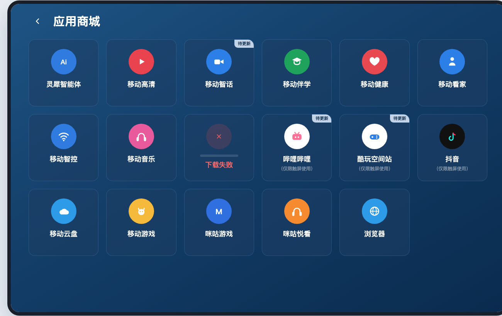
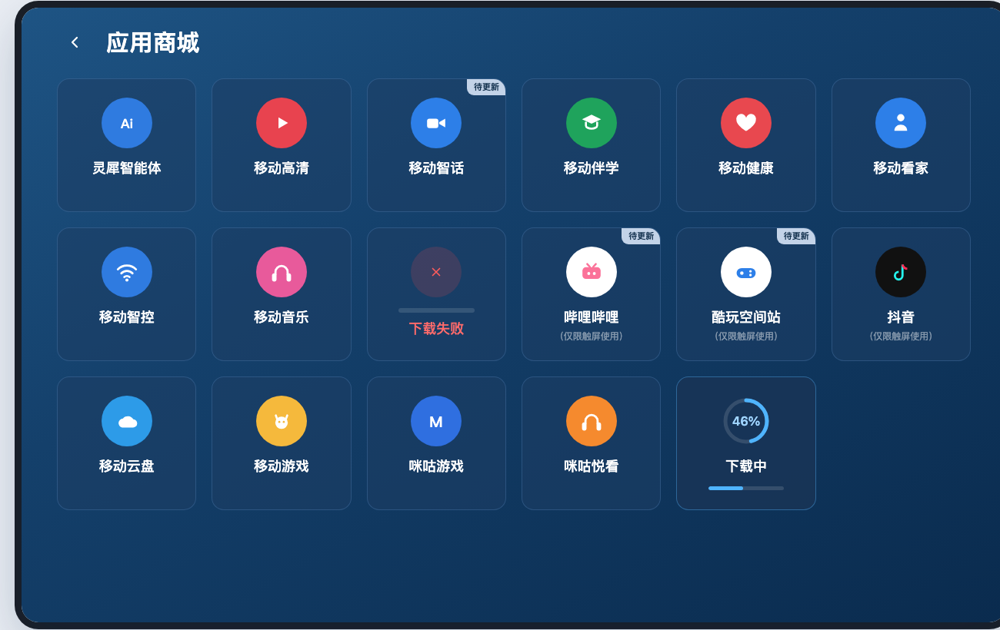
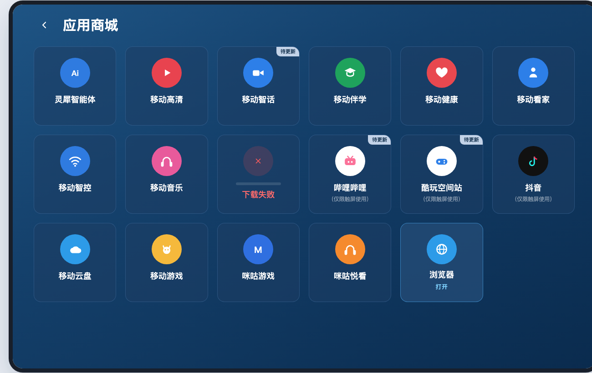
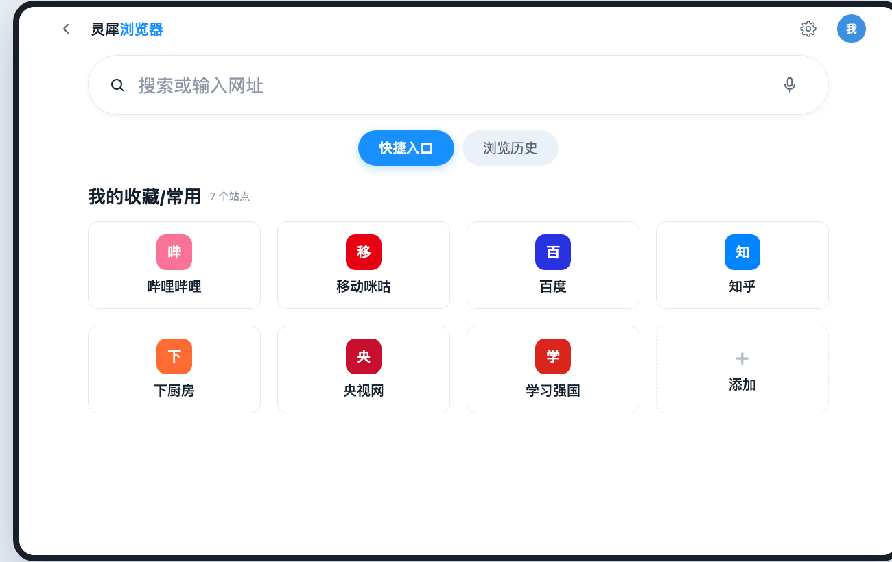
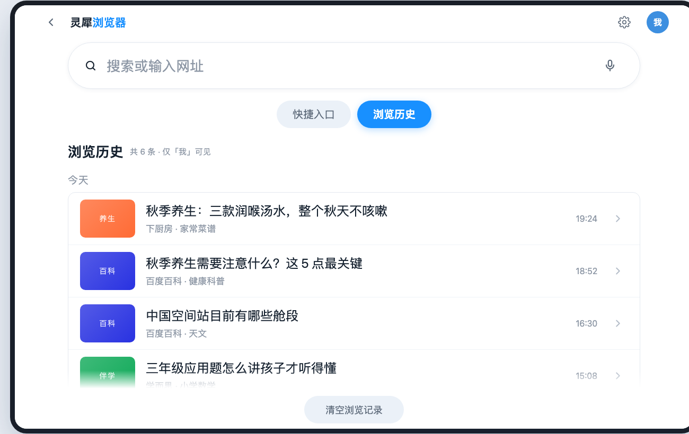
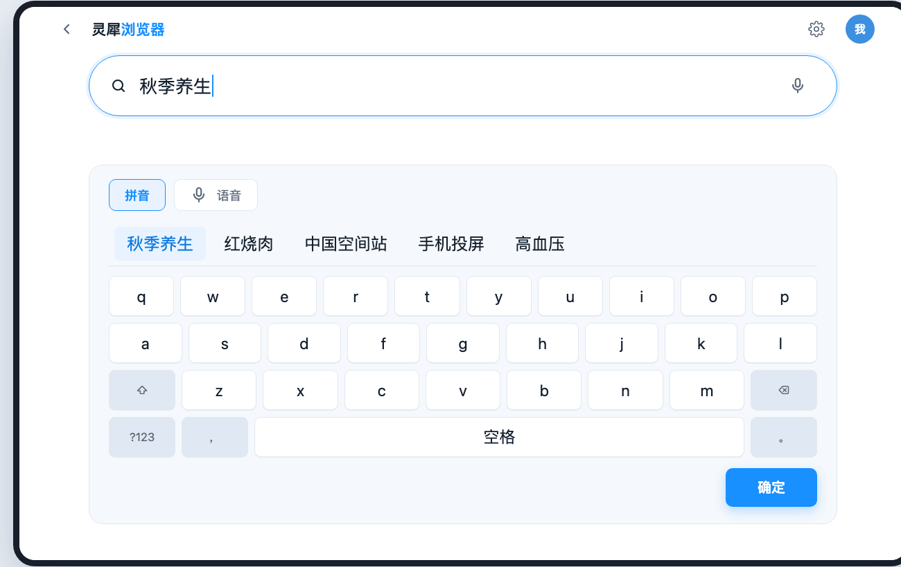
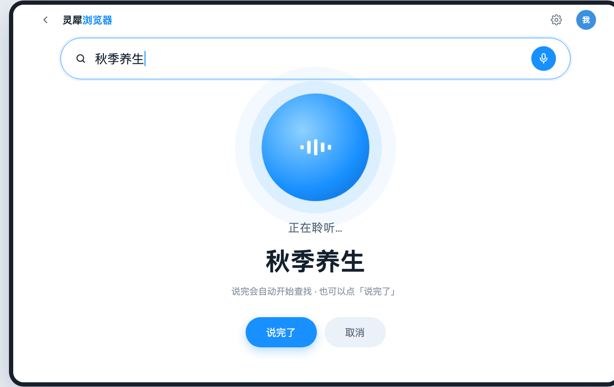
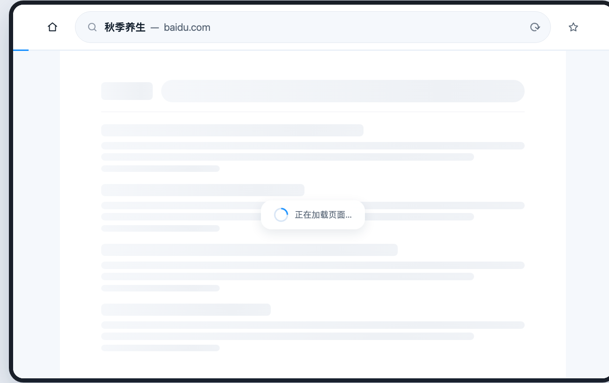
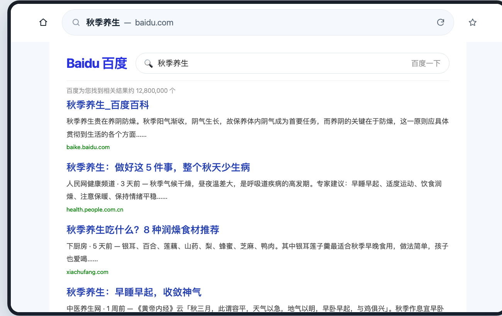
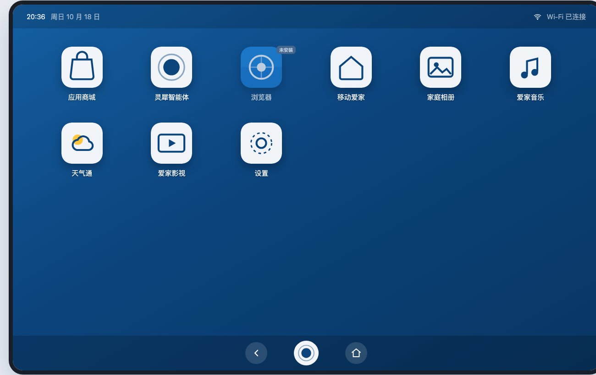

# 灵犀屏浏览器 · 高保真可交互 Demo

在灵犀屏（10.1 寸 1280×800 横屏）应用商城上架的浏览器 APK 的可交互原型。
**打开 `index.html` 即可交互**，右侧面板可直达任意页面，无需构建、无外部依赖（单文件）。

## 在线预览

GitHub Pages：`https://jeneyzhang016-cyber.github.io/lingxi-browser-demo/`

## 完整链路

```
应用商城（6 列网格）
   ↓ 点「浏览器」→ 原地下载（环形进度）
   ↓ 下载完成 → 卡片显示「打开」
   ↓ 点击 → 直接打开浏览器首页
浏览器首页（快捷入口 / 浏览历史 双 tab）
   ↓ 点搜索框 → 键盘输入    或    点麦克风 → 语音输入
   ↓ 确定 / 说完 → 自动搜索
网页浏览（地址栏 + 进度条 + 结果页，可收藏/刷新/回首页）
设置（字号三档 / 深色模式 / 阅读增强 / 家庭成员切换）
```

## 页面清单

| 页面 | 说明 | 深链接 |
| --- | --- | --- |
| 应用商城 | 17 个应用，含「待更新」「下载失败」状态 | `#view=shop` |
| 商城 · 下载中 | 环形进度 + 细进度条 | `#view=shop&dl=46` |
| 商城 · 已下载 | 高亮边框 + 「打开」 | `#view=shop&dl=done` |
| 灵犀屏桌面 | 未下载显示「未安装」，下载后显示 NEW | `#view=desktop` |
| 首页 · 快捷入口 | 7 个常去站点 + 添加（4×2） | `#view=home` |
| 首页 · 浏览历史 | 按成员隔离，清空需二次确认 | `#view=home&tab=history` |
| 键盘输入中 | 拼音候选 + 26 键 + 确定 | `#view=keyboard` |
| 语音输入中 | 呼吸球 + 实时字幕，说完自动搜索 | `#view=voice` |
| 网页搜索展示中 | 加载骨架 + 蓝色进度条 | `#view=web&loading=1` |
| 网页搜索结果 | 地址栏 / 星标 / 结果列表 / 相关搜索 | `#view=web` |
| 设置 | 字号 标准·大·特大、深色模式、成员切换 | `#view=settings&dark=1` |

深链接示例：`index.html#view=home&tab=history&font=1&dark=1`

## 设计取值（灵犀屏设计规范）

- 画布 1280 × 800（10.1" 横屏，安卓 9 基线）
- 主色 `#1890FF`，系统层深蓝 `#0C447C`
- 圆角：搜索框 44（胶囊）/ 卡片 14 / 面板 20
- 字号：正文 24–26px，标题 26–28px，触摸目标 ≥ 44×44px
- 浏览器内部为浅色主题；深色模式在设置中可切换

## 可交互热点

- 商城点「浏览器」→ 原地下载 → 点图标打开首页（不跳详情页）
- 首页点搜索框进键盘；点右侧麦克风进语音
- 键盘点字母出候选词 → 点候选上屏 → 点「确定」搜索
- 语音自动识别「秋季养生」并自动搜索
- 网页页可刷新、收藏、回首页、点搜索结果、点相关搜索词
- 首页 tab 切「浏览历史」→ 清空（二次确认弹层）
- 右上角设置 → 字号三档 / 深色模式 / 家庭成员切换
- 右侧面板可切 100% / 80% / 62% 缩放

## 截图

| | |
| --- | --- |
|  |  |
|  |  |
|  |  |
|  |  |
|  |  |

> 说明：这是交互原型，非真实 APK。商城内的其他 16 个应用为示意，仅「浏览器」可交互。
